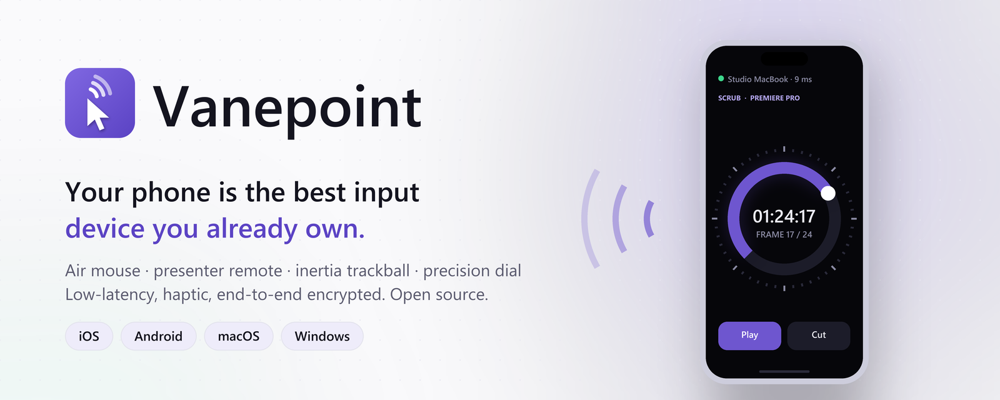
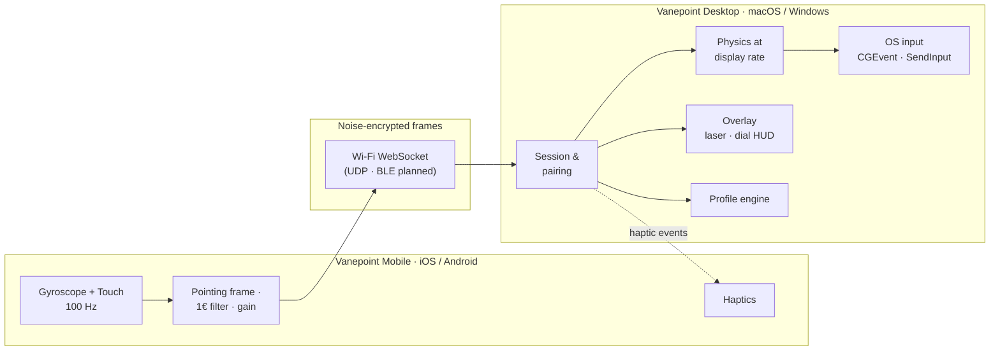

<div align="center">

<picture>
  <source media="(prefers-color-scheme: dark)" srcset="assets/banner-dark.png">
  
</picture>

<h3>Turn your phone into a low‑latency air mouse, presenter remote, inertia trackball and precision dial for your laptop.</h3>

<p>
  <a href="LICENSE"></a>
  
  
  <a href="CONTRIBUTING.md"></a>
</p>

<p>
  <a href="#-why-vanepoint">Why</a> ·
  <a href="#-features">Features</a> ·
  <a href="#-quick-start">Quick start</a> ·
  <a href="#-how-it-works">How it works</a> ·
  <a href="#-roadmap">Roadmap</a> ·
  <a href="CONTRIBUTING.md">Contribute</a>
</p>

</div>

---

> [!IMPORTANT]
> **Vanepoint v0.1 is a working developer preview.** The desktop app (Windows, macOS), the mobile app (iOS, Android via Expo), a headless agent and a phone simulator are all included and tested end to end. The latency targets below have **not yet been measured on hardware** — that is the next milestone. [Try it locally](docs/TESTING.md) or [join the discussion](https://github.com/vanepoint-hq/vanepoint/discussions).

## ✦ Why Vanepoint

Remote-control apps squeeze a desktop onto a phone screen. Presentation clickers, macro pads, and jog dials are single‑purpose hardware you forget at home. Yet the phone in your pocket has a calibrated gyroscope, a 120 Hz multi‑touch surface, and a precision haptic engine — better input hardware than most dedicated devices.

Vanepoint is a **native phone app** and a **menu‑bar desktop app** that turn that hardware into a family of input instruments, built around three non‑negotiables:

1. **It has to feel physical.** Velocity streaming with display‑rate integration, a 1€ filter against jitter, and a haptic language you learn in a minute.
2. **It has to just work.** One scan to pair, automatic reconnection, and per‑app layouts that switch with the focused application.
3. **It has to be trustworthy.** End‑to‑end encrypted with the Noise Protocol, paired devices only, no cloud in the input path, no telemetry.

## ✦ Features

| | Feature | What it does | Status |
| --- | --- | --- | :---: |
| 🎯 | **Present** | One giant *Next* target, swipe for *Previous*, hold for an on‑screen laser or spotlight, talk timer | ✅ v0.1 |
| ✈️ | **Air Pointer** | Point the phone and the cursor follows — gravity‑referenced (works however you hold it), 1€‑filtered, hold‑to‑point clutch | ✅ v0.1 |
| ▭ | **Trackpad** | Tap to click, two‑finger scroll and right‑click, pointer acceleration | ✅ v0.1 |
| ● | **Inertia Trackball** | Flick to glide across monitors with physically modelled friction; touch to stop | ✅ v0.1 |
| ◎ | **Rotary Dial** | One‑finger ring or two‑finger twist with a haptic tick per detent | ✅ v0.1 |
| 🧩 | **App Profiles** | Layouts switch with the focused app — PowerPoint, Keynote and Premiere Pro built in; add your own in JSON | ✅ v0.1 |
| 📳 | **Haptics** | Clicks, edge bumps, detents and connection alerts | ✅ v0.1 |
| 🛑 | **Kill switch** | `Ctrl+Alt+Shift+Esc` / `⌃⌥⌘ Esc` drops every session instantly | ✅ v0.1 |
| 📡 | **UDP & Bluetooth LE** | Lower tail latency, and a fallback when venue Wi‑Fi isolates devices | 🗓 Phase 2 |
| ✨ | **AI Profile Generator** | Claude drafts a validated profile for any app, *once*, outside the input path | 🗓 Phase 3 |
| ✍️ | **Gesture Pad** | Draw a symbol to trigger an action, recognised on device | 🗓 Phase 3 |

## ✦ Quick start

> Full walkthrough, including troubleshooting: **[docs/TESTING.md](docs/TESTING.md)**.

```bash
git clone https://github.com/vanepoint-hq/vanepoint.git
cd vanepoint
npm install                 # core, simulator and desktop UI
npm run mobile:install      # mobile app (separate Expo project)

npm test                    # TypeScript + Rust unit tests
npm run e2e                 # real agent vs. phone simulator (cursor untouched)

npm run desktop:dev         # desktop app with hot reload
npm run mobile:dev          # open the phone app in Expo Go
```

No phone handy? Run the agent in dry‑run mode and pair the simulator:

```bash
npm run agent -- --pair --dry-run
npm run simulate -- pair "vanepoint://pair?…"   # paste the code the agent printed
npm run simulate -- run --script demo
```

## ✦ How it works



- **The phone owns feel; the laptop owns smoothness.** The phone filters its sensors and sends velocities. The desktop integrates them at 120 Hz, so network jitter never shows up as cursor stutter, and a velocity expires after 50 ms so the cursor can't run away.
- **One crypto layer for every transport.** Pairing uses `Noise_IKpsk1` — the desktop key and a one‑time secret come from the QR code, so the desktop only prompts for approval after the phone proves it saw the *current* code. Reconnects use `Noise_IK` against an explicit trust list. Every frame carries an explicit nonce with a sliding replay window.
- **Profiles are data, never code.** They can only press keys, click and scroll — no shell or file access — and are validated before use.

Read the full design in [`docs/ARCHITECTURE.md`](docs/ARCHITECTURE.md), the wire format in [`docs/PROTOCOL.md`](docs/PROTOCOL.md), and the reasoning behind key decisions in the [ADRs](docs/adr/README.md).

## ✦ Performance targets

These are **design targets, not measurements**. A back-of-the-envelope [latency budget](docs/ARCHITECTURE.md#performance-budget) suggests a median of about 13 ms over Wi‑Fi; measuring it on real hardware is the next milestone, and results will be published in [`docs/benchmarks/`](docs/benchmarks/).

| Metric | Wi‑Fi (WebSocket) | Wi‑Fi (UDP) | Bluetooth LE |
| --- | :---: | :---: | :---: |
| Motion‑to‑injection, median | ≤ 15 ms | ≤ 15 ms | ≤ 25 ms |
| Motion‑to‑injection, p95 | ≤ 30 ms | ≤ 20 ms | ≤ 45 ms |
| Pointer jitter at rest | < 0.5 px RMS | < 0.5 px RMS | < 0.5 px RMS |
| Pairing, first run | < 60 s including OS permissions | | |

## ✦ Security & privacy

- **Pair once, by sight.** The QR code carries the desktop's public key and a one‑time secret that expires in 120 seconds; a used code can't be replayed.
- **Paired devices only.** Unknown phones are rejected during the handshake. Remove a phone with one click.
- **Local by design.** Input never leaves your network. No accounts, no analytics.

See [`SECURITY.md`](SECURITY.md) for the threat model and how to report a vulnerability, and [`PRIVACY.md`](PRIVACY.md) for the privacy policy.

## ✦ Tech stack

| Layer | Technology |
| --- | --- |
| Mobile | React Native + Expo SDK 58 (runs in Expo Go), `expo-sensors`, `expo-haptics`, `expo-camera`, `react-native-svg` |
| Desktop | Tauri 2 — Rust agent (`tokio`, `tokio-tungstenite`, `snow`, `enigo`, `mdns-sd`) with a React UI |
| Shared core | TypeScript protocol, Noise handshake and motion maths (`@noble/curves`, `@noble/ciphers`, `@noble/hashes`) |
| Crypto | Noise Protocol Framework: `IKpsk1` (pairing), `IK` (reconnect), 25519 · ChaChaPoly · BLAKE2s |
| Profiles | JSON validated against [`profiles/schema/profile.schema.json`](profiles/schema/profile.schema.json) |

## ✦ Repository layout

```text
vanepoint/
├── apps/
│   ├── desktop/          # Tauri app: src-tauri/ (Rust) + src/ (React UI and overlay)
│   └── mobile/           # Expo React Native app
├── crates/
│   ├── protocol/         # Wire format, frames, pairing URI
│   ├── session/          # Noise handshakes, transport, replay window, trust store
│   ├── physics/          # Velocity TTL, inertia, multi-display clamping
│   ├── input/            # OS input (enigo) or recording sink
│   ├── profiles/         # App profiles and focused-app matching
│   └── agent/            # Server, sessions, input engine + vanepoint-headless
├── packages/core/        # Shared TypeScript protocol, Noise and motion maths
├── tools/
│   ├── simulator/        # A command-line phone
│   └── e2e/              # End-to-end test: real agent vs simulator
├── profiles/             # Built-in app profiles + JSON Schema
└── docs/                 # Architecture, protocol, design system, testing, ADRs
```

## ✦ Roadmap

- [x] Concept, architecture, protocol and design system
- [x] **v0.1** — Pairing, encrypted sessions, Air Pointer, Trackpad, Present + laser, Trackball, Dial, haptics, app profiles, kill switch
- [ ] **Phase 0 measurements** — Hardware latency rig and published benchmarks
- [ ] **Phase 2** — UDP and Bluetooth LE transports, more profiles, custom haptic patterns
- [ ] **Phase 3** — AI profile generator, Gesture Pad, profile registry, Linux

Details and exit criteria live in [`ROADMAP.md`](ROADMAP.md).

## ✦ Contributing

Good first contributions:

- **App profiles** — add your favourite app in a single JSON file ([guide](docs/PROFILES.md)).
- **Device testing** — try it on your phone and report how the Air Pointer feels ([testing guide](docs/TESTING.md)).
- **Protocol review** — poke holes in the [protocol](docs/PROTOCOL.md) and [threat model](SECURITY.md).

Start with [`CONTRIBUTING.md`](CONTRIBUTING.md) and look for issues labelled [`good first issue`](https://github.com/vanepoint-hq/vanepoint/labels/good%20first%20issue). Everyone participating is expected to follow the [Code of Conduct](CODE_OF_CONDUCT.md).

## ✦ License

Vanepoint is released under the [MIT License](LICENSE).

<div align="center">
<sub>Built in Dublin with care. If Vanepoint is useful to you, a ⭐ helps others find it.</sub>
</div>
