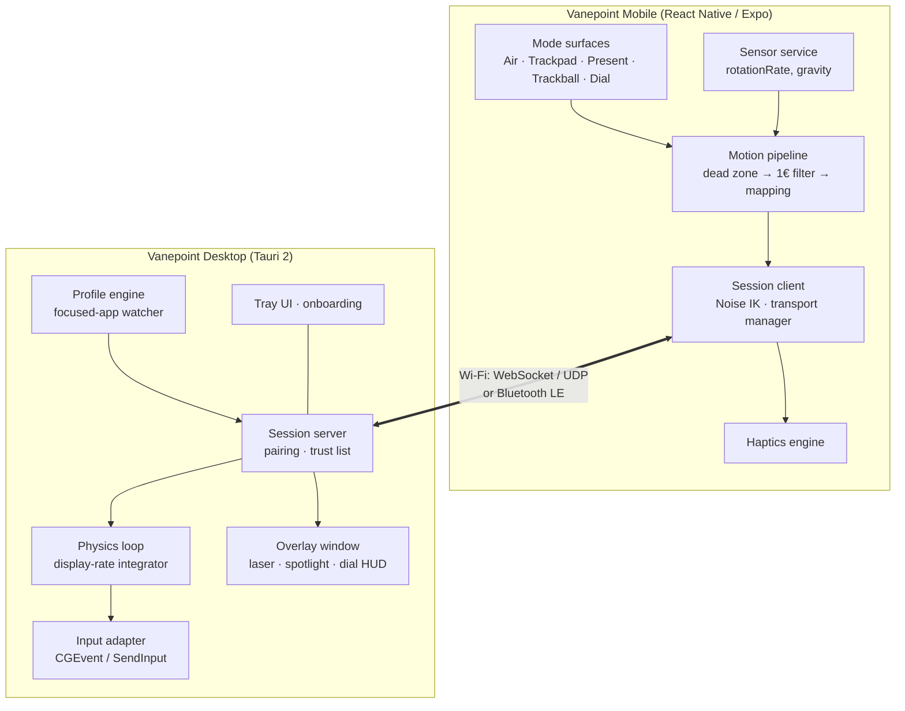
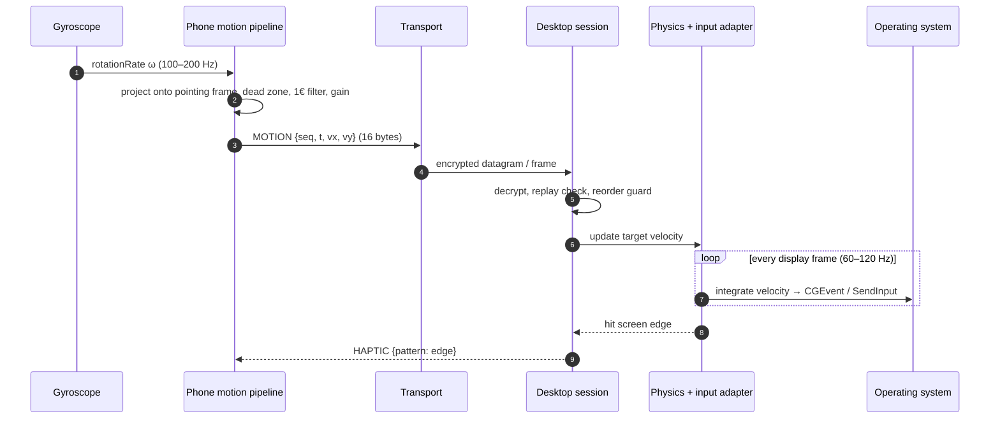

# Architecture

This document describes how Vanepoint is put together: the two applications, the shared core, the data path from a phone sensor to an operating-system input event, and the reasoning behind the main decisions. Decisions with long-term consequences are recorded as [ADRs](adr/README.md).

## Contents

- [System overview](#system-overview)
- [Design goals](#design-goals)
- [Components](#components)
- [The input path](#the-input-path)
- [Discovery, pairing and transports](#discovery-pairing-and-transports)
- [Profiles and the AI generator](#profiles-and-the-ai-generator)
- [Platform notes](#platform-notes)
- [Failure handling](#failure-handling)
- [Performance budget](#performance-budget)

## System overview



## Design goals

| ID | Goal | Measurable target |
| --- | --- | --- |
| G1 | Feels physical | Motion-to-injection p95 ≤ 30 ms (Wi-Fi), ≤ 45 ms (BLE) |
| G2 | Stable at rest | < 0.5 px RMS jitter at default gain |
| G3 | Zero-friction setup | First pairing < 60 s including OS permissions |
| G4 | Works on hostile networks | Automatic BLE fallback under client isolation |
| G5 | Secure by default | Mutual authentication, encryption, explicit trust list |
| G6 | Extensible | New app support in one JSON file; new transport behind one trait |

## Components

### Vanepoint Mobile

v0.1 deliberately uses only modules bundled in **Expo Go**, so anyone can run the app on a phone without building it.

| File / folder (`apps/mobile/src`) | Responsibility | Key libraries |
| --- | --- | --- |
| `surfaces/` | Present, Air, Trackpad, Trackball, Dial and profile Controls surfaces | `PanResponder`, `react-native-svg` |
| `motionSource.ts` | Device motion at ~100 Hz, normalised to one device frame (rad/s, gravity down) | `expo-sensors` |
| `useAirPointer.ts` | Pointing frame → 1€ filter → gain → `MOTION` | `@vanepoint/core` |
| `useTouchStream.ts` | Finger deltas → 60 Hz velocities, taps, scrolls, release samples | `@vanepoint/core` |
| `connection.tsx` | Pairing, Noise handshakes, reconnection with back-off, app lifecycle | `@vanepoint/core`, `expo-secure-store` |
| `haptics.ts` | Haptic vocabulary mapped onto `expo-haptics` primitives | `expo-haptics` |

The shared TypeScript core (`packages/core`) holds the protocol, the Noise implementation (on the audited `@noble` libraries) and the motion maths. It is used unchanged by the app, the simulator and the tests.

**Planned for a development build:** Reanimated/Skia UI-thread gestures, mDNS discovery, custom haptic patterns, a native high-rate sensor path, and the BLE peripheral role.

### Vanepoint Desktop

| Module (Rust crate) | Responsibility |
| --- | --- |
| `vanepoint-protocol` | Message types (serde), versioning, `typeshare` generation for TypeScript |
| `vanepoint-transport` | `Transport` trait with WebSocket, UDP, and BLE implementations |
| `vanepoint-session` | Noise `IKpsk1`/`IK` handshakes (`snow`), explicit-nonce transport, replay window, trust list, identity key |
| `vanepoint-input` | `InputSink` trait with macOS (`CGEvent`) and Windows (`SendInput`) backends |
| `vanepoint-physics` | Fixed-rate integrator for pointer velocity, inertia, and edge detection |
| `vanepoint-profiles` | Focused-app watcher, profile loading and schema validation |

The React UI (tray popover, onboarding wizard, overlay) talks to the Rust core through Tauri commands and events only.

## The input path



### Why the phone sends velocity, not position

1. **Jitter isolation.** If packets arrive in bursts, the desktop keeps integrating the last known velocity at display rate, so the cursor glides instead of stuttering.
2. **Loss tolerance.** A lost velocity sample costs one frame of slight inaccuracy; a lost position delta is a permanent error.
3. **Inertia lives in one place.** Trackball momentum, friction, and edge behaviour are computed on the desktop, which knows the monitor layout.

Velocity samples carry a **time-to-live** of 50 ms: if no new sample arrives, the desktop decays velocity to zero so the cursor never runs away after a connection drop.

### Air Pointer mapping (roll-invariant)

At recenter, the phone records gravity **ĝ** and its forward axis **f̂** in device coordinates. For each rotation-rate sample **ω**:

- horizontal angular rate: `ω_yaw = −ω · ĝ`
- vertical angular rate: `ω_pitch = ω · normalize(ĝ × f̂)`

Because both axes are defined relative to gravity, the cursor moves horizontally when you sweep horizontally, however you hold or roll the phone. iOS `CMDeviceMotion.rotationRate` is already bias-corrected by sensor fusion; Android uses `TYPE_GYROSCOPE` with a short stationary bias calibration at session start.

## Discovery, pairing and transports

- **Discovery:** the desktop advertises `_vanepoint._tcp` over mDNS/DNS-SD. The TXT record carries the protocol version and a short key fingerprint — never secrets.
- **Pairing:** the desktop's QR code carries its static public key, addresses, port, and a one-time 128-bit secret. The phone runs `Noise_IKpsk1` with that secret; afterwards both sides store each other's static keys. See [`PROTOCOL.md`](PROTOCOL.md#3-pairing).
- **Transports** all implement the same trait:

```rust
#[async_trait]
pub trait Transport: Send + Sync {
    fn kind(&self) -> TransportKind;           // WebSocket | Udp | Ble
    async fn send(&self, frame: &[u8]) -> Result<()>;
    async fn recv(&self) -> Result<Bytes>;
    fn reliability(&self) -> Reliability;      // Reliable | Datagram
    fn health(&self) -> LinkHealth;            // rtt, loss, last_seen
}
```

The **transport manager** ranks available links by measured RTT and loss, and migrates sessions without a new handshake (session keys are transport-independent).

| Transport | When used | Notes |
| --- | --- | --- |
| WebSocket (TCP, `TCP_NODELAY`) | Default in Phase 0–1 | Simple, reliable; head-of-line blocking under loss |
| UDP datagrams | Phase 2 default for motion | Explicit 64-bit nonce + replay window (WireGuard-style) |
| Bluetooth LE GATT | Wi-Fi unavailable or client isolation detected | Phone = peripheral, desktop = central (`btleplug`); 7.5–15 ms connection interval |

## Profiles and the AI generator

A **profile** maps a focused application to phone layouts and actions. Profiles are pure data, validated against [`profiles/schema/profile.schema.json`](../profiles/schema/profile.schema.json); they can only emit keyboard, mouse, and scroll actions.

The **AI Profile Generator** (Phase 3) runs entirely outside the input path:

1. The user names an app, optionally pastes its shortcut list or attaches a screenshot.
2. The desktop calls the Anthropic Messages API with the user's own key, constraining output to the profile JSON Schema.
3. The result is validated, linted (duplicate shortcuts, unsafe chords such as `⌘Q` without confirmation), and shown in a **review screen**.
4. Only after the user accepts it is the profile saved. It then runs locally with no further AI involvement.

See [ADR-0003](adr/0003-ai-outside-the-input-path.md).

## Platform notes

| Platform | Detail |
| --- | --- |
| macOS | Input via `CGEventPost`; needs **Accessibility** permission, granted to the signed Vanepoint app bundle. Onboarding deep-links to `x-apple.systempreferences:com.apple.preference.security?Privacy_Accessibility`. |
| Windows | Input via `SendInput`. Relative moves are affected by the user's pointer speed and "Enhance pointer precision" settings, so Vanepoint sends **absolute** coordinates (`MOUSEEVENTF_ABSOLUTE \| MOUSEEVENTF_VIRTUALDESK`) for deterministic gain. UIPI blocks injection into elevated windows; an optional elevated helper is planned. |
| iOS | Requires the **Local Network** permission (`NSLocalNetworkUsageDescription`, `NSBonjourServices`). Third-party apps cannot expose the Bluetooth HID profile, hence the custom GATT service. |
| Android | mDNS via `NsdManager` with a `WifiManager.MulticastLock`. Android 12+ caps sensor rates at 200 Hz without `HIGH_SAMPLING_RATE_SENSORS`. |

## Failure handling

| Failure | Detection | Behaviour |
| --- | --- | --- |
| Packet loss burst | Sequence gaps | Velocity TTL decays cursor to rest; no catch-up jump |
| Wi-Fi drop | Heartbeat miss (3 × 250 ms) | Haptic double-pulse; try BLE; reconnect silently |
| Phone screen lock | App lifecycle event | Keep-awake while connected; resume session on unlock in < 1 s |
| Desktop sleep | OS power notification | Session paused; phone shows "Laptop asleep" |
| Permission revoked | Input sink error | Tray icon turns amber; onboarding reopens at the permission step |
| Kill switch | Global hotkey | All sessions closed; pairing window closed; overlay hidden |

## Performance budget

Analytical estimate for the Wi-Fi WebSocket path (median), to be replaced by Phase 0 measurements:

| Stage | Estimate |
| --- | ---: |
| Sensor sampling (half of 10 ms period at 100 Hz) | 5.0 ms |
| Phone processing (filter, mapping, framing, encryption) | 0.5 ms |
| Wi-Fi one-way transit (uncontended LAN) | 3.0 ms |
| Desktop decrypt + session | 0.3 ms |
| Wait for next physics tick (half of 8.3 ms at 120 Hz) | 4.2 ms |
| Input injection | 0.3 ms |
| **Motion-to-injection total** | **≈ 13.3 ms** |
| Display composition + scan-out (60 Hz, average) | + 8–25 ms |
